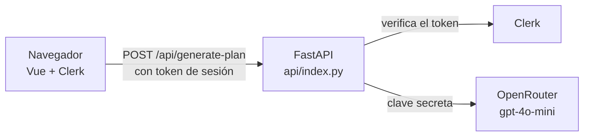

# StudyUp AI

Aplicación web que genera planes de estudio personalizados con Inteligencia Artificial.

- Vercel: https://study-up-beryl.vercel.app
- AWS, web en S3: http://studyup-web-david.s3-website-us-east-1.amazonaws.com
- AWS, API en EC2: http://3.211.14.178/api/health

## 1. Identificación

Práctica UD1, "Explotación y despliegue de una aplicación con IA", del módulo Explotación de Servicios de Procesamiento y Analítica de Datos (Curso de especialización de Inteligencia Artificial).

Integrantes y aportaciones:

- **davidodo123**: backend FastAPI, integración con OpenRouter, frontend Vue, tests, despliegue en Vercel, integración de Clerk, Docker, despliegue en AWS (S3 y EC2) y documentación.
- **[Integrante 2]**: [aportaciones].

**Miniapp elegida:** un generador de planes de estudio. El usuario elige cuatro datos en un único formulario:

- su meta: aprobar, sacar nota alta, memorizar o hacer un repaso exprés;
- los días que faltan para el examen, de 1 a 30;
- los recursos que tiene: apuntes, libro, vídeos, ejercicios o flashcards;
- su nivel de partida.

La IA devuelve un plan organizado por días, con la técnica de estudio, la duración y la carga de cada sesión, un calendario de repaso y una alternativa para los días con poco tiempo. Es una sola pantalla y una sola operación de IA, como pide el alcance de la práctica.

## 2. Plan de documentación

Este README está pensado para que otra persona pueda instalar, desplegar y comprobar la aplicación sin ayuda. También sirve para que el profesorado revise la configuración. Se ha seguido la idea de la [guía Diátaxis](https://diataxis.fr/) de separar la explicación (arquitectura y decisiones) de las instrucciones paso a paso (instalación, Vercel, Clerk), adaptada a un único documento.

El README se actualiza al cerrar cada hito, junto con el commit correspondiente, y se guardan las capturas en `evidencias/`. Para escribirlo se han usado Markdown con la vista previa de VS Code, tablas, un esquema en Mermaid y Git para revisar los cambios. El manual detallado de errores está en [`instrucciones.md`](instrucciones.md).

## 3. Arquitectura



El navegador muestra la interfaz en Vue. Clerk gestiona el inicio y el cierre de sesión, y entrega un token que el navegador envía en cada petición. FastAPI comprueba ese token con las claves públicas de Clerk. Solo si es válido llama a OpenRouter, valida lo que devuelve la IA y responde con el plan en JSON. La clave de OpenRouter solo existe en el servidor.

El mismo código se despliega de dos formas.

**En Vercel** todo es un único proyecto. El frontend se compila con Vite y se sirve como web estática, y `api/index.py` se ejecuta como función serverless, que solo se activa cuando llega una petición. Los dos están en el mismo dominio, así que no hace falta CORS. Vercel aporta HTTPS.

**En AWS** el despliegue tiene dos partes, como indicó el profesor:

- La web compilada está en un **bucket público de S3** configurado como sitio web estático.
- La API se ejecuta en un **único contenedor Docker en una EC2**, encendido de forma permanente.

Como la web y la API están en direcciones distintas, FastAPI activa CORS, limitado solo a la dirección del bucket. Hay además un segundo bucket, privado, donde se guarda la imagen Docker de cada versión. El acceso es por HTTP sin cifrar, una limitación aceptada por el enunciado para la demostración: hay que usar solo cuentas y datos de prueba.

La imagen Docker también puede servir la web y la API juntas en un solo contenedor (versión `v0.5-docker`). Esa fue la primera versión desplegada en EC2, antes de separar la web en S3.

## 4. Requisitos e instalación local

Versiones utilizadas: Node.js 24, Python 3.12, Vue 3.5, TypeScript 5.9, Vite 5.4, FastAPI 0.142, SDK de OpenAI 3.24, PyJWT 2.15 y `@clerk/vue` 2.5.

En Windows PowerShell 5.1 hay que ejecutar los comandos uno por línea, porque no acepta `&&`:

```powershell
git clone https://github.com/davidodo123/StudyUp.git
cd StudyUp
npm ci
python -m venv .venv
.venv\Scripts\Activate.ps1
pip install -r requirements-dev.txt
Copy-Item .env.example .env
```

Después se rellenan en `.env` la clave de OpenRouter y la clave publicable de Clerk (ver el apartado 5). La aplicación necesita dos terminales. En la primera, con el `.venv` activado, se arranca el backend:

```powershell
uvicorn api.index:app --reload --port 8000
```

En la segunda se arranca el frontend:

```powershell
npm run dev
```

Para comprobar que funciona, http://127.0.0.1:8000/api/health debe devolver `{"status":"ok"}` y http://localhost:5173 debe mostrar la pantalla de inicio de sesión. Después de entrar, al generar un plan debe aparecer el calendario por días.

## 5. Variables de entorno

| Nombre | Finalidad | Carácter | Dónde se configura | Cuándo se usa |
| --- | --- | --- | --- | --- |
| `OPENAI_API_KEY` | Clave de OpenRouter | Secreta | `.env` local y Vercel (tipo Secret) | Ejecución del backend |
| `OPENAI_BASE_URL` | Apunta el SDK de OpenAI a `https://openrouter.ai/api/v1` | Pública | `.env` local y Vercel | Ejecución del backend |
| `AI_MODEL` | Modelo de IA: `openai/gpt-4o-mini` | Pública | `.env` local y Vercel | Ejecución del backend |
| `VITE_CLERK_PUBLISHABLE_KEY` | Clave publicable de Clerk (`pk_test_...`) | Pública | `.env` local y Vercel | Compilación del frontend y ejecución del backend |
| `CLERK_AUTHORIZED_PARTIES` | Orígenes desde los que se aceptan sesiones | Pública | `.env` local, Vercel y `~/studyup.env` en EC2 | Ejecución del backend |
| `CORS_ORIGINS` | Orígenes que pueden llamar a la API desde otra dirección (el bucket de S3) | Pública | Solo `~/studyup.env` en EC2 | Ejecución del backend |
| `VITE_API_URL` | Dirección de la API cuando la web está en otro sitio (`http://3.211.14.178`) | Pública | `--build-arg` al compilar la web para S3 | Compilación del frontend |
| `FRONTEND_DIR` | Carpeta de la web que sirve FastAPI. La define el `Dockerfile`; en la API de EC2 se vacía con `-e FRONTEND_DIR=` | Pública | `Dockerfile` | Ejecución del backend |

El archivo `.env` está en `.gitignore` y nunca se sube. En el repositorio solo está [`.env.example`](.env.example), con valores de ejemplo. En EC2, las variables están en un archivo privado, `~/studyup.env`, con permisos `600`. Ese archivo está fuera del repositorio y no entra en la imagen.

Las variables que empiezan por `VITE_` se meten en el código que descarga el navegador, así que nunca deben contener un secreto. Si cambia una de ellas, hay que volver a compilar y desplegar. No se usa la clave secreta de Clerk, porque el backend verifica los tokens con las claves públicas que publica Clerk.

## 6. Vercel

El repositorio es un único proyecto de Vercel (`study-up`) conectado a GitHub. Vercel detecta Vite a partir de `package.json` y compila el frontend en `dist/`. Instala `requirements.txt`, que solo lleva las dependencias de producción, para la función Python. [`vercel.json`](vercel.json) envía todas las rutas `/api/*` a `api/index.py`. Los tests están en `tests/` y no en `api/`, porque Vercel convertiría cualquier archivo `.py` de esa carpeta en una función.

Las variables del apartado 5 se añadieron en **Environment Variables** con el tipo Secret y el entorno Production. Cada `git push` a `main` genera un despliegue nuevo. Cuando se cambian variables, hay que volver a desplegar, porque no se aplican a los despliegues ya construidos.

**Operaciones con Vercel CLI:** pendiente. Faltan por documentar `vercel link`, `vercel ls`, un despliegue de prueba y el de producción con `vercel --prod`, `vercel env add` y `vercel env ls`, y `vercel inspect` o `vercel logs`.

URL: https://study-up-beryl.vercel.app. Versión desplegada: rama `main` (tag pendiente).

## 7. Clerk

Se usa una **instancia de desarrollo** de Clerk, como permite el enunciado.

**Inicio y cierre de sesión.** En el frontend, [`src/main.ts`](src/main.ts) registra el plugin de Clerk con la clave publicable y los textos en español. En [`src/App.vue`](src/App.vue), el formulario solo aparece con la sesión iniciada (`<Show when="signed-in">`). Sin sesión, la pantalla muestra un botón que abre el inicio de sesión de Clerk. Con sesión, el botón de usuario de arriba a la derecha permite cerrarla. En cada petición, el frontend obtiene el token de sesión con `useAuth().getToken` y lo envía en la cabecera `Authorization: Bearer`.

**Validación en el backend.** Ocultar el formulario no basta, así que la validación real está en FastAPI. En [`api/index.py`](api/index.py), la dependencia `get_current_user` se ejecuta antes del endpoint `/api/generate-plan`. Usa PyJWT y las claves públicas de Clerk (JWKS, con caché de una hora), y comprueba:

- la firma;
- que el algoritmo sea RS256;
- el emisor, que se deduce de la clave publicable;
- la caducidad y los campos obligatorios;
- que el origen del token (`azp`) esté en `CLERK_AUTHORIZED_PARTIES`.

Si algo falla, responde 401 sin llegar a llamar a la IA. El endpoint de salud sigue siendo público, porque no revela información.

**Orígenes.** En local se acepta `http://localhost:5173`. En Vercel, `https://study-up-beryl.vercel.app`. En AWS, la dirección del bucket de S3. El inicio de sesión de Clerk funciona también en este origen HTTP.

**Evidencia del rechazo sin token:**

```powershell
curl.exe -i -X POST https://study-up-beryl.vercel.app/api/generate-plan -H "Content-Type: application/json" -d "{\"meta\":\"aprobar\",\"dias_disponibles\":5,\"recursos\":[\"apuntes\"],\"nivel\":\"intermedio\"}"
```

Responde `401 Unauthorized` con el mensaje "Debes iniciar sesión para generar un plan.". Con un token inventado, la respuesta es `401` con "La sesión no es válida.". Estado: funciona en local y en Vercel, después de añadir las variables de Clerk y volver a desplegar. Faltan las capturas.

## 8. Docker

El [`Dockerfile`](Dockerfile) tiene dos etapas, dentro de una sola imagen:

- **`frontend`**: con Node 22, instala las dependencias y compila la web. Recibe la clave publicable de Clerk y, si hace falta, `VITE_API_URL`.
- **La final**: con Python 3.12, instala las dependencias de producción y `uvicorn`, y copia la API y la web compilada. Se ejecuta con un usuario sin permisos de root, escucha en `0.0.0.0:8000` y comprueba su salud cada 30 segundos con `/api/health`.

El [`.dockerignore`](.dockerignore) deja fuera `.env`, las claves `.pem`, `node_modules`, `.git`, los tests y la documentación. Los secretos se pasan al **ejecutar** el contenedor con `--env-file`, así que nunca están en la imagen ni en sus capas.

```bash
# Construir la imagen
sudo docker build --build-arg VITE_CLERK_PUBLISHABLE_KEY=pk_test_... -t studyup:v0.6 .

# Ejecutar: un único contenedor, puerto 80 del host al 8000, reinicio automático
sudo docker run -d --name studyup --restart unless-stopped -p 80:8000 --env-file ~/studyup.env -e FRONTEND_DIR= studyup:v0.6

# Estado, logs, parar, arrancar y reiniciar
sudo docker ps
sudo docker logs --tail 20 studyup
sudo docker stop studyup
sudo docker start studyup
sudo docker restart studyup
```

Si cambia `~/studyup.env`, hay que recrear el contenedor (`docker rm -f studyup` y el mismo `docker run`), porque `docker restart` no vuelve a leer el archivo.

La imagen se construyó y se probó en la propia EC2, porque el ordenador de trabajo no tiene Docker. Antes, la misma configuración (FastAPI sirviendo la web compilada) se comprobó en local sin Docker.

## 9. AWS

**EC2.**

- Instancia `studyup` con Ubuntu Server 24.04, tipo `t2.small`, en la región `us-east-1` (Norte de Virginia).
- Tiene asignado el rol de IAM `LabInstanceProfile` del Learner Lab, para usar S3 sin guardar claves.
- Tiene una **IP elástica** (`3.211.14.178`) para que la dirección no cambie al parar el laboratorio.
- La conexión es por SSH con una clave `.pem` guardada fuera del repositorio.
- Docker se instaló desde el repositorio oficial, siguiendo la guía G17.

**Security Group.** Solo tiene dos reglas de entrada: SSH (22) desde la IP del puesto de trabajo y HTTP (80) desde cualquier origen, para la demo. El puerto 8000 del contenedor no está abierto hacia fuera.

**S3.** Hay dos buckets, uno para cada uso:

- `studyup-imagenes-david` es **privado** y guarda las imágenes Docker de cada versión (`imagenes/studyup-v0.5.tar.gz`, `imagenes/studyup-v0.6.tar.gz`). Así la imagen se puede recuperar o volver a una versión anterior sin reconstruirla.
- `studyup-web-david` es **público** y tiene activado el alojamiento de sitio web estático. Su política solo permite leer los archivos (`s3:GetObject`).

**Despliegue (versión `v0.6-s3`).** Se hace dentro de la EC2:

```bash
cd ~/StudyUp && git fetch --tags && git checkout v0.6-s3

# Web: compilar con la dirección de la API y subirla al bucket público
sudo docker build --target frontend --build-arg VITE_CLERK_PUBLISHABLE_KEY=pk_test_... \
  --build-arg VITE_API_URL=http://3.211.14.178 -t studyup-web:v0.6 .
sudo rm -rf ./dist-s3
sudo docker create --name web-tmp studyup-web:v0.6
sudo docker cp web-tmp:/app/dist ./dist-s3
sudo docker rm web-tmp
aws s3 sync ./dist-s3 s3://studyup-web-david --delete

# API: construir, guardar la imagen en el bucket privado y arrancar el contenedor
sudo docker build --build-arg VITE_CLERK_PUBLISHABLE_KEY=pk_test_... -t studyup:v0.6 .
sudo docker save studyup:v0.6 | gzip | aws s3 cp - s3://studyup-imagenes-david/imagenes/studyup-v0.6.tar.gz
sudo docker rm -f studyup
sudo docker run -d --name studyup --restart unless-stopped -p 80:8000 --env-file ~/studyup.env -e FRONTEND_DIR= studyup:v0.6
```

Para recuperar una versión guardada en S3:

```bash
aws s3 cp s3://studyup-imagenes-david/imagenes/studyup-v0.6.tar.gz - | gunzip | sudo docker load
```

**Actualizar a una versión nueva:** se repiten esos pasos con el tag nuevo. Primero se cambia `git checkout` al tag nuevo y después se compila y se sube la web, se construye y se guarda la imagen, y se sustituye el contenedor.

**CLI de AWS.** No se ha creado ninguna cuenta ni se ha escrito ninguna clave. Dentro de la EC2, la CLI usa el rol `LabInstanceProfile`. Con ella se han consultado el estado de la instancia, la IP elástica, las reglas del Security Group y el contenido de los buckets. Esas llamadas quedan registradas en CloudTrail, donde el campo *userAgent* indica `aws-cli`.

```bash
aws ec2 describe-instances --filters "Name=tag:Name,Values=studyup" --query "Reservations[].Instances[].{Nombre:Tags[?Key=='Name']|[0].Value,Estado:State.Name,Tipo:InstanceType,IP:PublicIpAddress}" --output table
aws s3 ls s3://studyup-imagenes-david/imagenes/ --human-readable
aws s3api get-public-access-block --bucket studyup-imagenes-david
```

**Al terminar la práctica:**

- Parar o terminar la instancia.
- Desasociar y liberar la IP elástica.
- Vaciar y borrar los dos buckets.

## 10. Operación y verificación

**Tests automáticos.** Ninguno llama a la IA real: el proveedor se sustituye por uno simulado y los tokens de Clerk se firman con una clave generada en el propio test.

- `pytest -v`: 24 tests del backend, todos pasan. Comprueban:
  - un plan correcto;
  - las entradas incorrectas (422);
  - los errores de la IA: respuesta vacía, JSON roto, esquema incompleto y días que no existen (502);
  - la falta de clave (500);
  - la autenticación (401): sin token, con token mal formado, firmado con otra clave, de otro emisor, de otro origen, con algoritmo HS256 o caducado;
  - el contenedor: la web servida sin tapar la API;
  - CORS: solo se permite el bucket y no se activa sin `CORS_ORIGINS`.
- `npm test`: 9 tests del frontend, todos pasan. Comprueban el formulario, el envío con token, el plan por días, los errores, el bloqueo durante la carga y la pantalla sin sesión.
- `npm run typecheck`: 0 errores.

**Comprobaciones manuales en Vercel:**

- `/api/health` responde 200.
- Un plan de 5 días tarda unos 6 segundos y uno de 30 días, unos 32.
- Ni la clave de OpenRouter ni ningún secreto aparecen en el código servido al navegador.
- Los registros de cada despliegue se consultan en la pestaña Deployments del proyecto.

**Comprobaciones manuales en AWS**, hechas desde fuera de AWS:

- La web del bucket responde 200, lleva grabada la dirección de la API y no contiene ningún secreto.
- El bucket de imágenes responde 403, así que es privado.
- La API responde en `http://3.211.14.178/api/health`.
- La API da 401 sin token y con un token inventado.
- El *preflight* de CORS solo devuelve permiso para la dirección del bucket.
- El puerto 8000 está cerrado.

Dentro de la EC2, `docker ps` muestra el contenedor como `healthy` y `docker logs` no muestra errores.

## 11. Problemas y soluciones

**Los planes largos devolvían error 502.** A partir de unos 14 días, la respuesta de la IA llegaba al límite de 2000 tokens y se cortaba (`finish_reason: length`), así que el JSON no era válido. Pedir un tope de sesiones de forma general en el prompt no funcionó, porque el modelo lo ignoraba. La solución fue calcular en el servidor un número máximo de 14 sesiones e incluirlo en el prompt, y pedir consejos de una sola frase. Se comprobó con planes de 5, 10, 20 y 30 días: todos terminan correctamente, y el de 30 ocupa unos 1400 tokens.

**Error 500 en Vercel después de añadir la clave.** La web respondía "La variable de entorno OPENAI_API_KEY no está configurada" aunque la variable ya estaba guardada. Las variables solo se aplican a despliegues nuevos, así que se resolvió con Redeploy, y se comprobó que la generación de planes funcionaba.

**El README no aparecía en GitHub.** El archivo original estaba codificado en UTF-16 y GitHub lo trataba como binario. Se convirtió a UTF-8.

**Entorno de Python roto al cambiar de ordenador.** El `.venv` copiado desde otro equipo apuntaba a una ruta de Python que no existía (`No Python at ...`). Un entorno virtual no se puede mover, así que se borró y se creó de nuevo.

**No se podía conectar por SSH a la EC2 (*Connection timed out*).** En la configuración de SSH seguía la IP de una instancia anterior. Se cambió por la IP pública de la instancia nueva, y se comprobó con `Test-NetConnection` que el puerto 22 respondía.

**La web de EC2 no cargaba desde fuera aunque el contenedor estaba `healthy`.** Dentro de la instancia, `curl http://localhost/api/health` funcionaba, pero desde fuera la conexión expiraba. Faltaba la regla de entrada HTTP (80) en el Security Group. Al añadirla, la web respondió al momento.

**"La sesión procede de un origen no autorizado" desde la web de S3.** El inicio de sesión funcionaba, pero la API rechazaba el token. Con `docker exec studyup printenv CLERK_AUTHORIZED_PARTIES` se vio que el contenedor tenía el valor antiguo, porque `~/studyup.env` se había editado después de crearlo. Se recreó el contenedor y la generación de planes funcionó.

**La IP pública cambiaba al parar el laboratorio.** La web de S3 lleva grabada la dirección de la API, así que cada cambio de IP obligaba a recompilarla. Se asoció una IP elástica a la instancia, se recompiló la web una vez con esa IP y se comprobó que la nueva versión ya no contenía la IP antigua.

**Fallos de la plantilla de la práctica.** Usaba una configuración de CORS que los navegadores rechazan, tenía los tests dentro de `api/` (Vercel los habría publicado como funciones), no cargaba el `.env` y usaba una versión de `vue-tsc` incompatible con TypeScript 5.5 o superior. Se corrigieron todos.

## 12. Git y evidencias

Historial principal en la rama `main`, con los commits de cada cambio.

Tags por hitos:

- **Publicados:**
  - `v0.5-docker`: un único contenedor con la web y la API.
  - `v0.6-s3`: la web en S3 y la API en EC2.
- **Pendientes:** `v0.1-backend`, `v0.2-frontend`, `v0.3-vercel` y `v0.4-auth`.
- `v1.0-aws` se moverá al commit final.

Evidencias: se guardarán en `evidencias/`, sin claves, números de cuenta ni datos personales.

- **Vercel:** el proyecto y las variables (solo los nombres).
- **Clerk:** el inicio y el cierre de sesión, un plan generado con la sesión iniciada y el rechazo con 401 sin token.
- **AWS:**
  - la instancia EC2 y las reglas del Security Group;
  - la IP elástica;
  - `docker ps` y `docker logs`;
  - los dos buckets;
  - la web de S3 generando un plan.

Documentación complementaria: [`pract01-studyup.md`](pract01-studyup.md) es la memoria técnica, con requisitos y diagramas UML, y [`instrucciones.md`](instrucciones.md) es el manual detallado.
