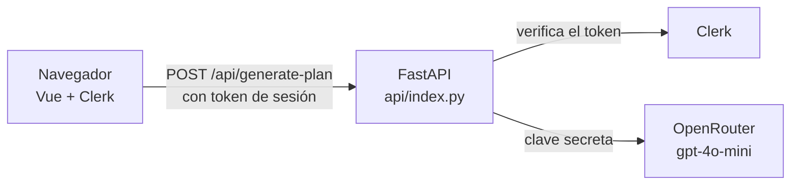

# StudyUp AI

Aplicación web que genera planes de estudio personalizados con Inteligencia Artificial.

- Web en Vercel: https://study-up-beryl.vercel.app
- Web en AWS EC2: pendiente (fase 6)

## 1. Identificación

Práctica UD1, "Explotación y despliegue de una aplicación con IA", del módulo Explotación de Servicios de Procesamiento y Analítica de Datos (Curso de especialización de Inteligencia Artificial).

Integrantes y aportaciones:

- **davidodo123**: backend FastAPI, integración con OpenRouter, frontend Vue, tests, despliegue en Vercel, integración de Clerk y documentación.
- **[Integrante 2]**: [aportaciones].

**Miniapp elegida:** un generador de planes de estudio. El usuario elige cuatro datos en un único formulario:

- su meta: aprobar, sacar nota alta, memorizar o hacer un repaso exprés;
- los días que faltan para el examen, de 1 a 30;
- los recursos que tiene: apuntes, libro, vídeos, ejercicios o flashcards;
- su nivel de partida.

La IA devuelve un plan organizado por días, con la técnica de estudio, la duración y la carga de cada sesión, un calendario de repaso y una alternativa para los días con poco tiempo. Es una sola pantalla y una sola operación de IA, como pide el alcance de la práctica.

## 2. Plan de documentación

Este README está pensado para que otra persona pueda instalar, desplegar y comprobar la aplicación sin ayuda. También sirve para que el profesorado revise la configuración. Se ha seguido la idea de la [guía Diátaxis](https://diataxis.fr/) de separar la explicación (arquitectura y decisiones) de las instrucciones paso a paso (instalación, Vercel, Clerk), adaptada a un único documento.

El README se actualiza al cerrar cada hito, junto con el commit correspondiente, y se guardan las capturas en `evidencias/`. Para escribirlo se han usado Markdown con la vista previa de VS Code, tablas, un esquema en Mermaid y Git para revisar los cambios. El manual detallado de errores está en [`instrucciones.md`](instrucciones.md).

## 3. Arquitectura



El navegador muestra la interfaz en Vue. Clerk gestiona el inicio y el cierre de sesión, y entrega un token que el navegador envía en cada petición. FastAPI comprueba ese token con las claves públicas de Clerk. Solo si es válido llama a OpenRouter, valida lo que devuelve la IA y responde con el plan en JSON. La clave de OpenRouter solo existe en el servidor.

**En Vercel** todo es un único proyecto. El frontend se compila con Vite y se sirve como web estática, y `api/index.py` se ejecuta como función serverless, que solo se activa cuando llega una petición. Los dos están en el mismo dominio, así que no hace falta CORS.

**En EC2 con Docker** (pendiente), un único contenedor ejecutará FastAPI de forma permanente y servirá también el frontend ya compilado.

## 4. Requisitos e instalación local

Versiones utilizadas: Node.js 24, Python 3.12, Vue 3.5, TypeScript 5.9, Vite 5.4, FastAPI 0.142, SDK de OpenAI 3.24, PyJWT 2.15 y `@clerk/vue` 2.5.

En Windows PowerShell 5.1 hay que ejecutar los comandos uno por línea, porque no acepta `&&`:

```powershell
git clone https://github.com/davidodo123/StudyUp.git
cd StudyUp
npm ci
python -m venv .venv
.venv\Scripts\Activate.ps1
pip install -r requirements-dev.txt
Copy-Item .env.example .env
```

Después se rellenan en `.env` la clave de OpenRouter y la clave publicable de Clerk (ver el apartado 5). La aplicación necesita dos terminales. En la primera, con el `.venv` activado, se arranca el backend:

```powershell
uvicorn api.index:app --reload --port 8000
```

En la segunda se arranca el frontend:

```powershell
npm run dev
```

Para comprobar que funciona, http://127.0.0.1:8000/api/health debe devolver `{"status":"ok"}` y http://localhost:5173 debe mostrar la pantalla de inicio de sesión. Después de entrar, al generar un plan debe aparecer el calendario por días.

## 5. Variables de entorno

| Nombre | Finalidad | Carácter | Dónde se configura | Cuándo se usa |
| --- | --- | --- | --- | --- |
| `OPENAI_API_KEY` | Clave de OpenRouter | Secreta | `.env` local y Vercel (tipo Secret) | Ejecución del backend |
| `OPENAI_BASE_URL` | Apunta el SDK de OpenAI a `https://openrouter.ai/api/v1` | Pública | `.env` local y Vercel | Ejecución del backend |
| `AI_MODEL` | Modelo de IA: `openai/gpt-4o-mini` | Pública | `.env` local y Vercel | Ejecución del backend |
| `VITE_CLERK_PUBLISHABLE_KEY` | Clave publicable de Clerk (`pk_test_...`) | Pública | `.env` local y Vercel | Compilación del frontend y ejecución del backend |
| `CLERK_AUTHORIZED_PARTIES` | Orígenes desde los que se aceptan sesiones | Pública | `.env` local y Vercel | Ejecución del backend |

El archivo `.env` está en `.gitignore` y nunca se sube. En el repositorio solo está [`.env.example`](.env.example), con valores de ejemplo.

Las variables que empiezan por `VITE_` se meten en el código que descarga el navegador, así que nunca deben contener un secreto. Si cambia una de ellas, hay que volver a compilar y desplegar. No se usa la clave secreta de Clerk, porque el backend verifica los tokens con las claves públicas que publica Clerk.

## 6. Vercel

El repositorio es un único proyecto de Vercel (`study-up`) conectado a GitHub. Vercel detecta Vite a partir de `package.json` y compila el frontend en `dist/`. Instala `requirements.txt`, que solo lleva las dependencias de producción, para la función Python. [`vercel.json`](vercel.json) envía todas las rutas `/api/*` a `api/index.py`. Los tests están en `tests/` y no en `api/`, porque Vercel convertiría cualquier archivo `.py` de esa carpeta en una función.

Las variables del apartado 5 se añadieron en **Environment Variables** con el tipo Secret y el entorno Production. Cada `git push` a `main` genera un despliegue nuevo. Cuando se cambian variables, hay que volver a desplegar, porque no se aplican a los despliegues ya construidos.

**Operaciones con Vercel CLI:** pendiente. Faltan por documentar `vercel link`, `vercel ls`, un despliegue de prueba y el de producción con `vercel --prod`, `vercel env add` y `vercel env ls`, y `vercel inspect` o `vercel logs`.

URL: https://study-up-beryl.vercel.app. Versión desplegada: rama `main` (tag pendiente).

## 7. Clerk

Se usa una **instancia de desarrollo** de Clerk, como permite el enunciado.

**Inicio y cierre de sesión.** En el frontend, [`src/main.ts`](src/main.ts) registra el plugin de Clerk con la clave publicable y los textos en español. En [`src/App.vue`](src/App.vue), el formulario solo aparece con la sesión iniciada (`<Show when="signed-in">`). Sin sesión, la pantalla muestra un botón que abre el inicio de sesión de Clerk. Con sesión, el botón de usuario de arriba a la derecha permite cerrarla. En cada petición, el frontend obtiene el token de sesión con `useAuth().getToken` y lo envía en la cabecera `Authorization: Bearer`.

**Validación en el backend.** Ocultar el formulario no basta, así que la validación real está en FastAPI. En [`api/index.py`](api/index.py), la dependencia `get_current_user` se ejecuta antes del endpoint `/api/generate-plan`. Usa PyJWT y las claves públicas de Clerk (JWKS, con caché de una hora), y comprueba:

- la firma;
- que el algoritmo sea RS256;
- el emisor, que se deduce de la clave publicable;
- la caducidad y los campos obligatorios;
- que el origen del token (`azp`) esté en `CLERK_AUTHORIZED_PARTIES`.

Si algo falla, responde 401 sin llegar a llamar a la IA. El endpoint de salud sigue siendo público, porque no revela información.

**Orígenes.** En local se acepta `http://localhost:5173`. En Vercel, `https://study-up-beryl.vercel.app`.

**Evidencia del rechazo sin token:**

```powershell
curl.exe -i -X POST https://study-up-beryl.vercel.app/api/generate-plan -H "Content-Type: application/json" -d "{\"meta\":\"aprobar\",\"dias_disponibles\":5,\"recursos\":[\"apuntes\"],\"nivel\":\"intermedio\"}"
```

La respuesta esperada es `401 Unauthorized` con el mensaje "Debes iniciar sesión para generar un plan." Estado: funciona en local. Faltan el redespliegue en Vercel con las variables de Clerk y las capturas.

## 8. Docker

Pendiente (fase 5). Se preparará un `Dockerfile` por etapas: una compila el frontend con Node y la imagen final ejecuta FastAPI, que servirá también los archivos estáticos. Habrá un `.dockerignore` que excluya `.env` y `node_modules`. Los secretos se pasarán al ejecutar el contenedor, nunca al construir la imagen.

## 9. AWS

Pendiente (fase 6): instancia EC2 Linux con Docker, un único contenedor con política de reinicio y un Security Group que solo abra SSH desde la IP necesaria y el puerto web para la demo.

## 10. Operación y verificación

**Tests automáticos.** Ninguno llama a la IA real: el proveedor se sustituye por uno simulado y los tokens de Clerk se firman con una clave generada en el propio test.

- `pytest -v`: 21 tests del backend, todos pasan. Comprueban:
  - un plan correcto;
  - las entradas incorrectas (422);
  - los errores de la IA: respuesta vacía, JSON roto, esquema incompleto y días que no existen (502);
  - la falta de clave (500);
  - la autenticación (401): sin token, con token mal formado, firmado con otra clave, de otro emisor, de otro origen, con algoritmo HS256 o caducado.
- `npm test`: 9 tests del frontend, todos pasan. Comprueban el formulario, el envío con token, el plan por días, los errores, el bloqueo durante la carga y la pantalla sin sesión.
- `npm run typecheck`: 0 errores.

**Comprobaciones manuales en Vercel:**

- `/api/health` responde 200.
- Un plan de 5 días tarda unos 6 segundos y uno de 30 días, unos 32.
- Ni la clave de OpenRouter ni ningún secreto aparecen en el código servido al navegador.
- Los registros de cada despliegue se consultan en la pestaña Deployments del proyecto.

## 11. Problemas y soluciones

**Los planes largos devolvían error 502.** A partir de unos 14 días, la respuesta de la IA llegaba al límite de 2000 tokens y se cortaba (`finish_reason: length`), así que el JSON no era válido. Pedir un tope de sesiones de forma general en el prompt no funcionó, porque el modelo lo ignoraba. La solución fue calcular en el servidor un número máximo de 14 sesiones e incluirlo en el prompt, y pedir consejos de una sola frase. Se comprobó con planes de 5, 10, 20 y 30 días: todos terminan correctamente, y el de 30 ocupa unos 1400 tokens.

**Error 500 en Vercel después de añadir la clave.** La web respondía "La variable de entorno OPENAI_API_KEY no está configurada" aunque la variable ya estaba guardada. Las variables solo se aplican a despliegues nuevos, así que se resolvió con Redeploy, y se comprobó que la generación de planes funcionaba.

**El README no aparecía en GitHub.** El archivo original estaba codificado en UTF-16 y GitHub lo trataba como binario. Se convirtió a UTF-8.

**Entorno de Python roto al cambiar de ordenador.** El `.venv` copiado desde otro equipo apuntaba a una ruta de Python que no existía (`No Python at ...`). Un entorno virtual no se puede mover, así que se borró y se creó de nuevo.

**Fallos de la plantilla de la práctica.** Usaba una configuración de CORS que los navegadores rechazan, tenía los tests dentro de `api/` (Vercel los habría publicado como funciones), no cargaba el `.env` y usaba una versión de `vue-tsc` incompatible con TypeScript 5.5 o superior. Se corrigieron todos.

## 12. Git y evidencias

Historial principal en la rama `main`, con los commits de cada cambio.

Tags por hitos: pendientes (`v0.1-backend`, `v0.2-frontend`, `v0.3-vercel`, `v0.4-auth`, `v0.5-docker`, `v1.0-aws`).

Evidencias: se guardarán en `evidencias/`, sin claves ni datos personales. Serán el proyecto y las variables de Vercel (solo los nombres), el inicio y el cierre de sesión, un plan generado con la sesión iniciada, el rechazo con 401 sin token y, más adelante, el contenedor y la instancia EC2.

Documentación complementaria: [`pract01-studyup.md`](pract01-studyup.md) es la memoria técnica, con requisitos y diagramas UML, y [`instrucciones.md`](instrucciones.md) es el manual detallado.
